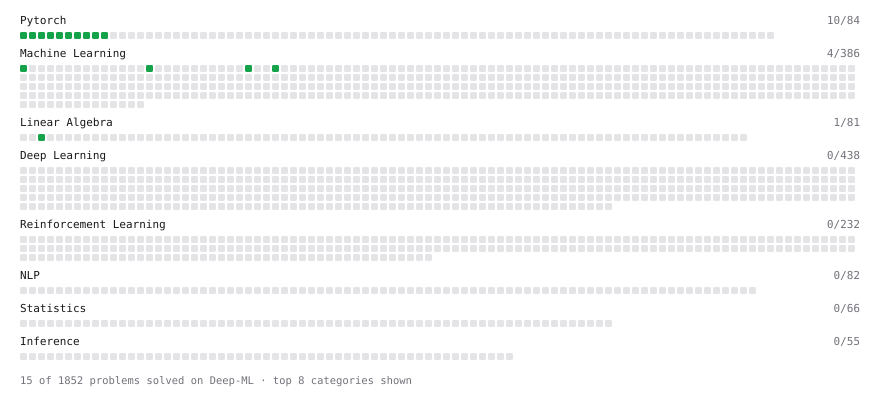

# Deep-ML

My machine learning practice from [Deep-ML](https://www.deep-ml.com). Every solution here was written by hand.

**3** solved · 3 problems · 0 labs · 0 math

[**Browse the interactive portfolio**](https://sejal04-hash.github.io/deep-ml/) to replay this filling in over time.

## Problems

| | Difficulty | Solved | |
| --- | --- | --- | --- |
| [Add a Bias Vector to a Batch via Broadcasting](https://www.deep-ml.com/problems/882) | easy | 2026-10-23 | [solution](problems/0882-add-a-bias-vector-to-a-batch-via-broadcasting) |
| [Create a Float Tensor from a Python List](https://www.deep-ml.com/problems/880) | easy | 2026-10-23 | [solution](problems/0880-create-a-float-tensor-from-a-python-list) |
| [Reshape and Transpose a Tensor](https://www.deep-ml.com/problems/881) | easy | 2026-10-23 | [solution](problems/0881-reshape-and-transpose-a-tensor) |

---

_This file is regenerated by Deep-ML on every push._
